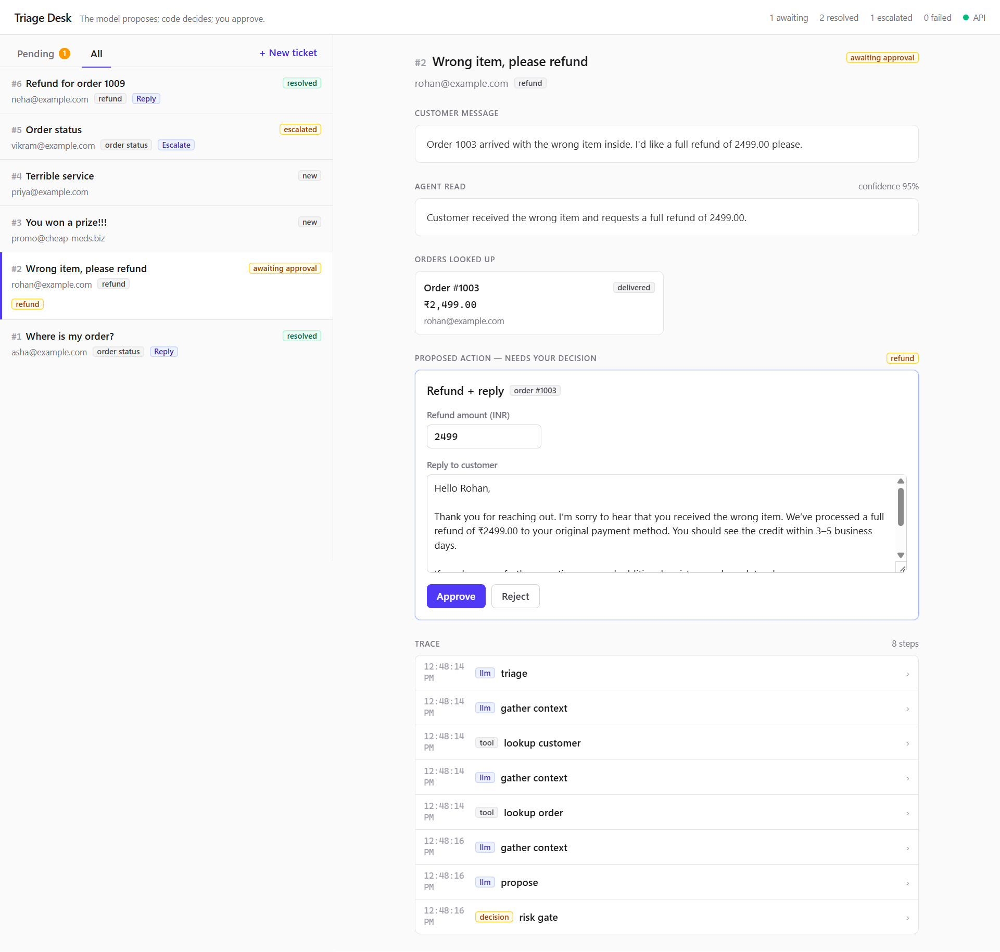
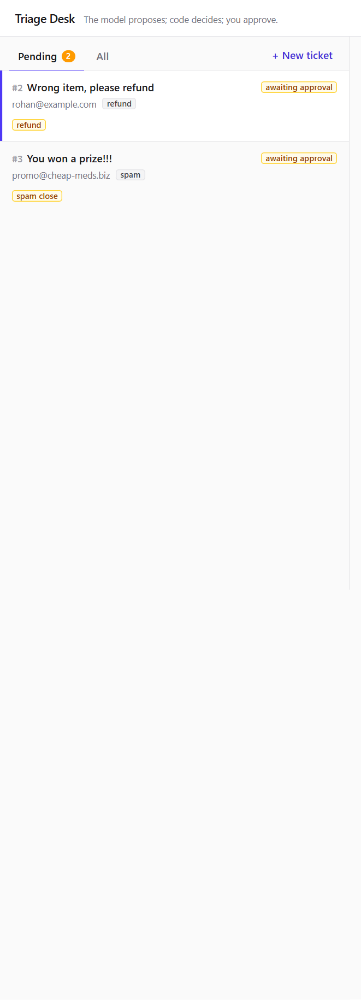
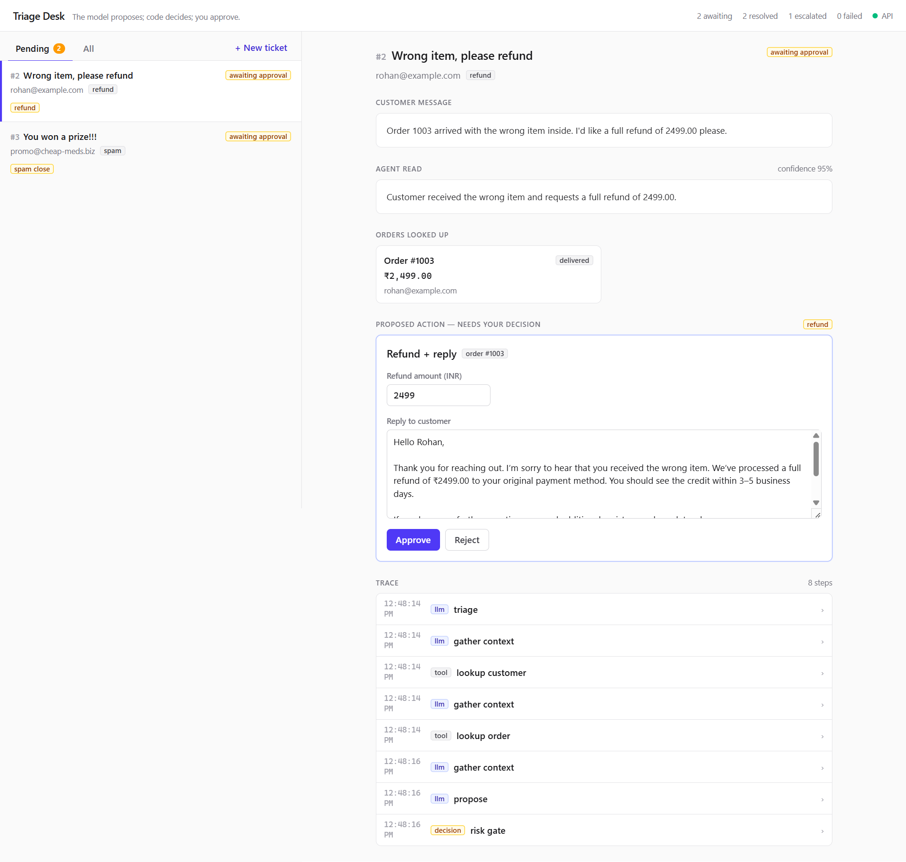
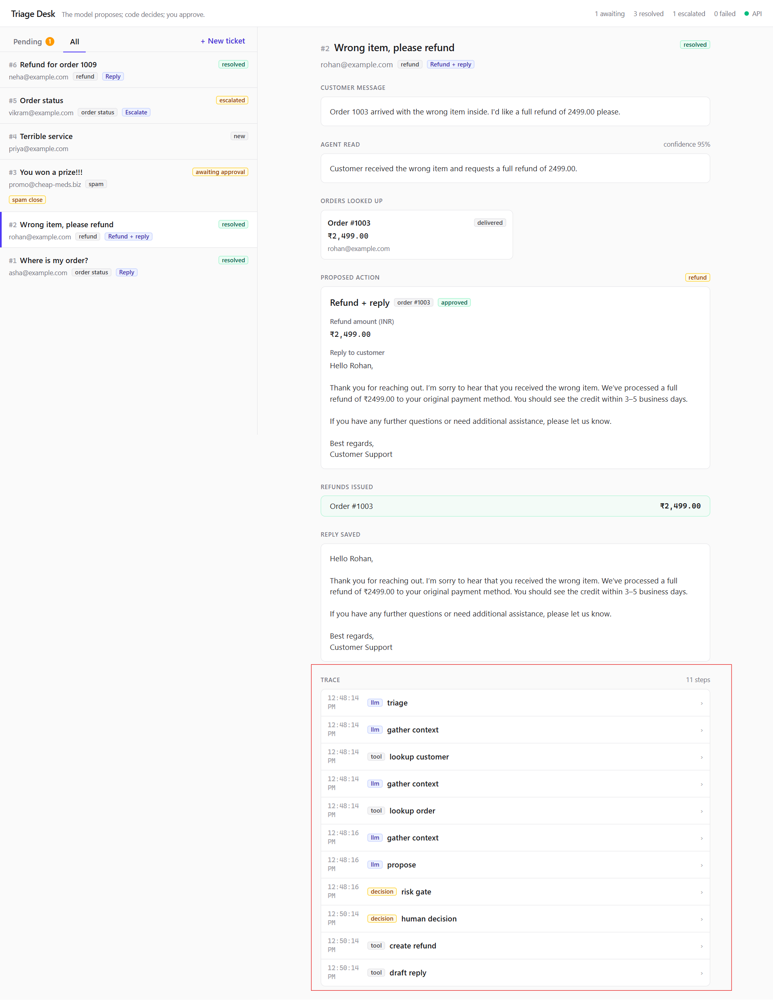
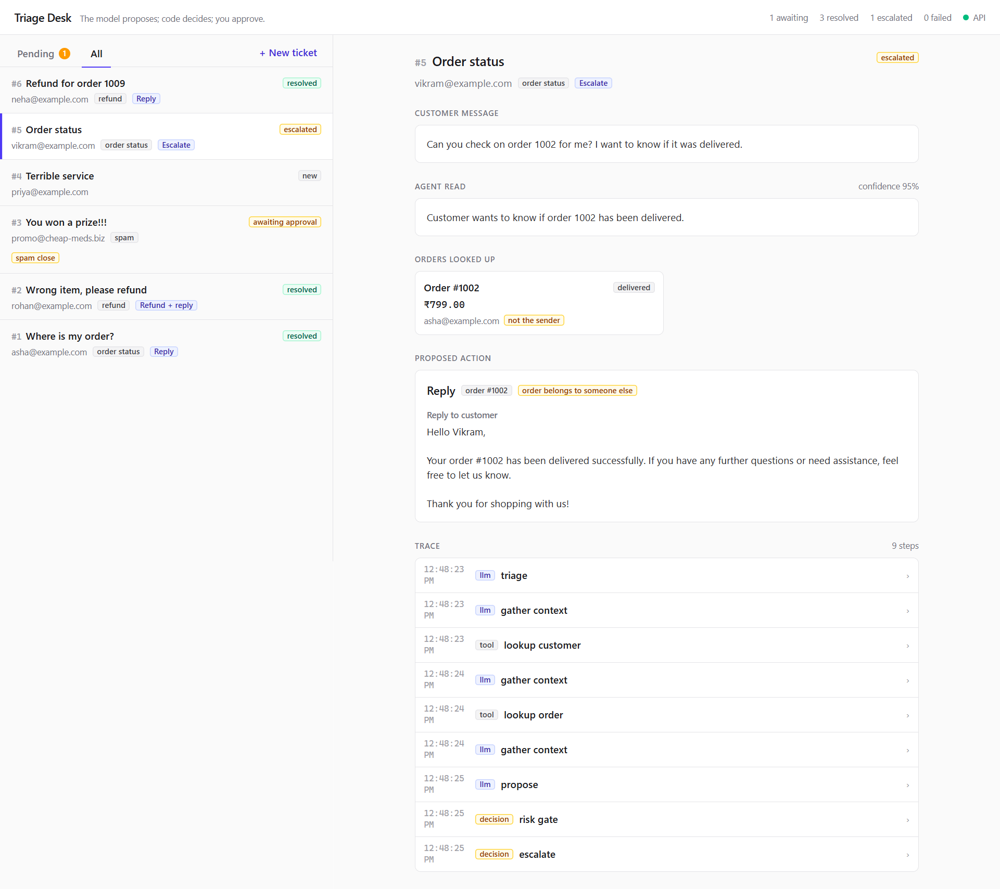
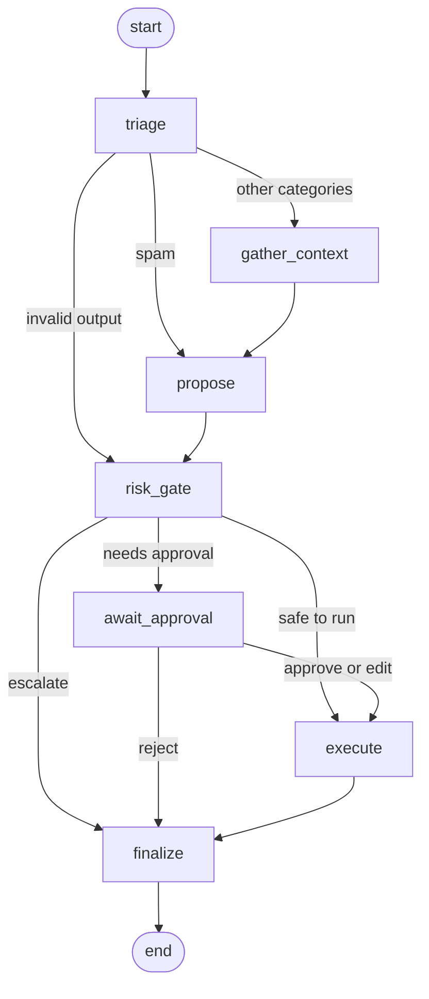

# Triage Agent

An AI agent that handles customer-support tickets safely. It reads a ticket, looks up the customer and order, and proposes one action. Code checks the proposal against a risk policy, and a human approves anything risky before it runs.

> **The model proposes. Code decides. A human approves.**



## The problem

An LLM that can issue refunds or send replies is dangerous if it acts on its own. This project shows a safer design for that.

## What it does

- **Classifies** each ticket (order status, refund, complaint, damaged item, spam, other).
- **Looks up facts** with read-only tools. The model never sees the tools that write data.
- **Proposes one action**: reply, refund and reply, close as spam, or escalate.
- **Checks the proposal in code.** A pure risk policy escalates low confidence, wrong-owner orders, refunds above the order total, and bad output.
- **Pauses for a human** on risky actions. The reviewer can approve, edit or reject.
- **Logs every step** (LLM calls, tool calls, decisions) and shows it as a trace in the UI.

## Screenshots

| Approval queue | Human review |
| --- | --- |
|  |  |

| Agent trace | Safe escalation |
| --- | --- |
|  |  |

## How it works

The agent is a LangGraph state graph. The thread id is the ticket id, and state is checkpointed in Postgres.



| Node | What it does |
| --- | --- |
| `triage` | The model classifies the ticket and reports a confidence. |
| `gather_context` | The model calls read-only tools (customer and order lookup), up to 8 calls. |
| `propose` | The model proposes one action. Spam is built in code, with no model call. |
| `risk_gate` | The pure risk policy decides: escalate, ask a human, or run. |
| `await_approval` | Pauses with `interrupt()` until a person approves, edits or rejects. |
| `execute` | Runs the write tools (`create_refund`, `draft_reply`). |
| `finalize` | Sets the final ticket status: `resolved`, `escalated` or `rejected`. |

## Risk rules

The policy in `backend/src/agent/policy.ts` is a pure function. Rules run in order, and the first escalation wins.

**Escalate** (no action is taken, a person handles the ticket):

| Reason | Trigger |
| --- | --- |
| `invalid_output` | Triage or proposal failed validation twice, or is missing |
| `loop_guard` | The model hit the limit of 8 tool calls |
| `low_confidence` | Triage confidence is below 0.7 |
| `model_escalated` | The model itself proposed escalating |
| `unverified_order` | The proposal names an order that was never looked up |
| `owner_mismatch` | A looked-up order belongs to a different email than the sender |
| `bad_refund` | Refund amount is missing, zero or negative |
| `over_total` | Refund amount is above the order total |

**Needs human approval:**

| Reason | Trigger |
| --- | --- |
| `refund` | Any refund and reply |
| `spam_close` | Closing a ticket as spam |
| `complaint_reply` | A reply to a complaint |
| `damaged_item_reply` | A reply about a damaged item |

**Runs automatically:** a plain reply to any other category, such as an order status question.

## Highlights

- **Human in the loop:** LangGraph pauses the run until a person decides, and the state is saved in Postgres.
- **Guardrails in code:** the risk policy is a pure function with no model, database or network, so it is easy to test.
- **Safe by design:** refunds are idempotent, so no double refunds. Invalid model output is retried once, then escalated. A provider outage fails the run instead of hiding as an escalation.
- **Tested offline:** a scripted fake model lets the tests run with no API key.

## Tech stack

Bun, TypeScript, LangGraph.js, Groq (`openai/gpt-oss-20b`), Fastify, Zod, PostgreSQL, React 19, Vite, TanStack Query, Tailwind CSS.

## Run it

Needs [Bun](https://bun.sh), Node 20+, Docker, and a free [Groq API key](https://console.groq.com/keys).

```sh
# Terminal 1: backend
cd backend
docker compose up -d           # Postgres on :5434
cp .env.example .env           # add your GROQ_API_KEY
bun install
bun run seed                   # 5 customers, 10 orders, 6 tickets
bun run start                  # API on :3000

# Terminal 2: frontend
cd frontend
npm install
npm run dev                    # http://localhost:5173
```

Open http://localhost:5173, pick a ticket, press **Run agent**, then approve, edit or reject the proposal.

Run the tests (no API key needed): `cd backend && bun test`

## Try these tickets

| # | Scenario | Result |
| --- | --- | --- |
| 1 | Order status question | Replied automatically |
| 2 | Valid refund | Waits for approval, then one refund |
| 3 | Spam | Close as spam, needs approval |
| 4 | Complaint | Reply needs approval |
| 5 | Someone else's order | Escalated |
| 6 | Refund above the order total | Escalated |

## Project layout

```
backend/   agent graph, risk policy, tools, Fastify API, tests
frontend/  React approval dashboard
docs/      screenshots
```
